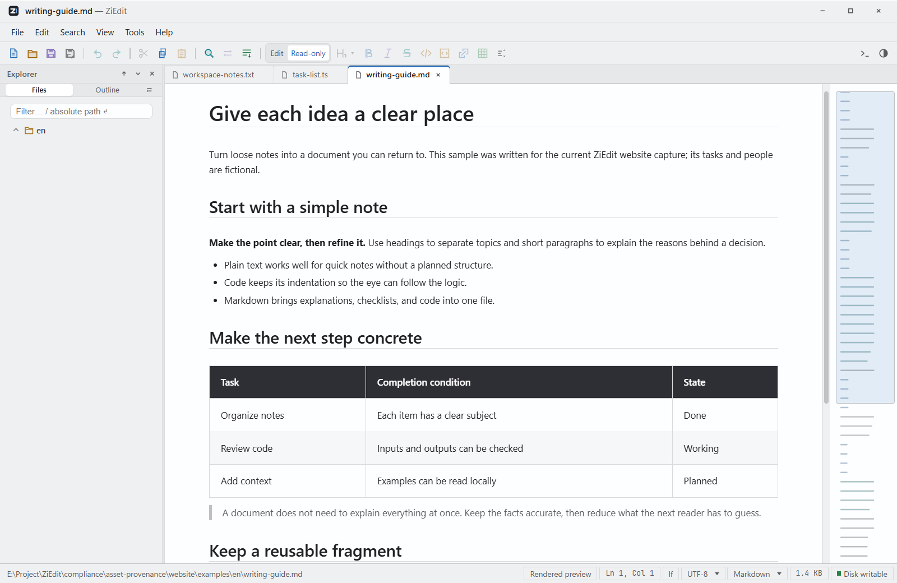
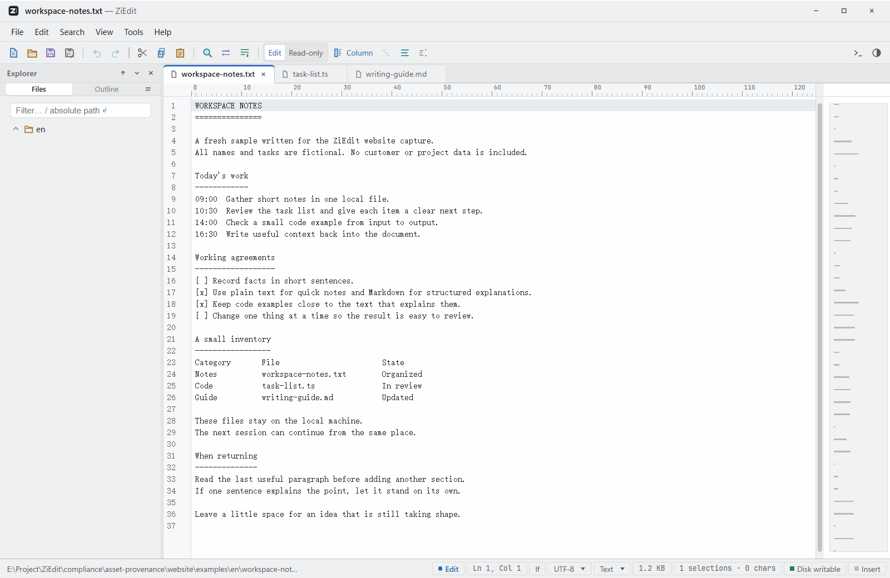
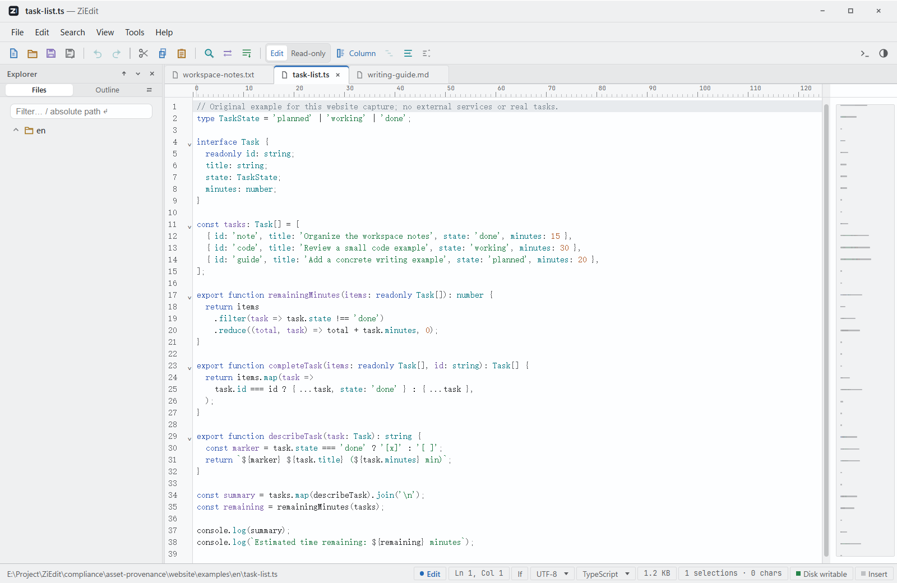

# ZiEdit

[中文](README.md) | **[English](README.en.md)**

A cross-platform, offline-first desktop file viewer and editor for Windows / macOS / Linux, built with Tauri 2 + Rust + CodeMirror 6.

Everything runs locally — no account required, no data uploaded. The only optional network feature is an S3-compatible image host that you configure yourself.

[](https://github.com/sylx-c/ZiEdit/releases/latest)
[](LICENSE)
[](https://github.com/sylx-c/ZiEdit/releases/latest)

<div align="center">

</div>

<!-- Demo GIF: record a 20–30 s clip of real usage (e.g. open a large text file → split-screen Markdown editing → two-file comparison),
     save it as website/shots/demo.gif and insert here:
      -->

**One window, many formats**: text / code / Markdown / CSV / TSV / images / docx / xlsx / PDF, plus two-file comparison.

| Plain text · automatic encoding detection | Source code · syntax highlighting |
|:---:|:---:|
|  |  |

## Download

<p align="center">
<a href="https://github.com/sylx-c/ZiEdit/releases/latest"></a>
</p>

- **Windows x64**: the [latest release](https://github.com/sylx-c/ZiEdit/releases/latest) provides the NSIS installer (SHA-256 checksum included).
- **macOS / Linux**: the same release provides dmg / AppImage / deb / rpm packages (CI builds, untested on real machines; only Windows has been verified on real hardware).

## Features

**Multi-format viewing and comparison**
- Image viewer (png / jpg / gif / webp / bmp / svg), CSV/TSV tables (switchable delimiters)
- Read-only docx / xlsx extraction, and full-page PDF rendering (continuous scroll, zoom, rotation; canvas-based, so in-text selection and full-text search are not supported)
- Two-file comparison: side-by-side / unified / A-B views with automatic difference classification (homoglyphs, Unicode normalization, invisible characters, whitespace, content)

**Text and code**
- Large-file viewing: virtual scrolling + chunked reading keeps log-scale files instant; log tail panel with polling refresh
- Editing: rectangular/column selections and column editing, paste matrix, bookmarks, find & replace (single and multi-file), jump-to-line
- Encodings: four-stage detection (BOM → in-file declaration → heuristic → manual override) covering GBK / GB18030 / UTF-8/16/32 / Shift_JIS and more; save with converted encoding or Unicode normalization
- Auto-save and crash-recovery snapshots

**Markdown**
- Four modes — source / preview / split / what-you-see-is-what-you-get — with incremental live rendering
- MathJax formulas, Mermaid diagrams, worker-based code highlighting, GFM table editing, outline navigation, formatting
- Optional S3 image-host upload (deduplication, rename templates; credentials stay in session memory only)

**Workbench**
- File tree (multi-select, favorites, recent files, filtering), command palette, native file icons
- Themes, font import, UI zooming, bilingual interface (zh-CN / en-US)
- System file associations: images, text/config files, Markdown, JSON/YAML/XML, CSV, and 24 source-code extensions

## User guide

Read the bilingual [User Guide](docs/USER-GUIDE.md#ziedit-user-guide) for saving and recovery, PDF/Office viewing, sessions, log tailing, shortcuts and other common tasks.

## Changelog

See [docs/CHANGELOG.md](docs/CHANGELOG.md) for version history, and [Releases](https://github.com/sylx-c/ZiEdit/releases) for per-release packages and SHA-256 checksums.

## Build from source

Engineering version 1.0.1. Requirements:

- Node.js 24, npm
- Rust stable (via rustup)
- Linux: `libwebkit2gtk-4.1-dev libappindicator3-dev librsvg2-dev patchelf`
- macOS: Xcode Command Line Tools; Windows: WebView2 (bundled with the system or auto-installed)

```bash
git clone https://github.com/sylx-c/ZiEdit.git
cd ZiEdit
npm ci
npm run tauri dev      # development run
npm run tauri build    # build installers (Windows NSIS / macOS dmg.app / Linux appimage deb rpm)
```

Set `ZIEDIT_CHANNEL=release` to build with the release channel (otherwise the About dialog shows a dev build).

Frontend-only development (without the desktop shell): `npm run dev`.

## Development

Common commands, test organization, and pre-commit gates are described in [CONTRIBUTING.md](CONTRIBUTING.md); CI is defined in `.github/workflows/ci.yml`.

- Frontend tests: `npm test` (vitest, organized by acceptance IDs ac-0XX)
- Rust tests: `cargo test --manifest-path src-tauri/Cargo.toml`

## Contributing

See [CONTRIBUTING.md](CONTRIBUTING.md) · For security issues see [SECURITY.md](SECURITY.md)

## License

[MIT](LICENSE). Licenses of third-party components distributed with the app (MathJax, Mermaid, highlight.js, JetBrains Mono, etc.) are listed in [THIRD-PARTY-NOTICES.md](THIRD-PARTY-NOTICES.md).
