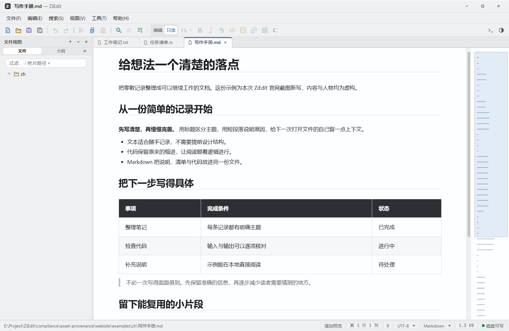
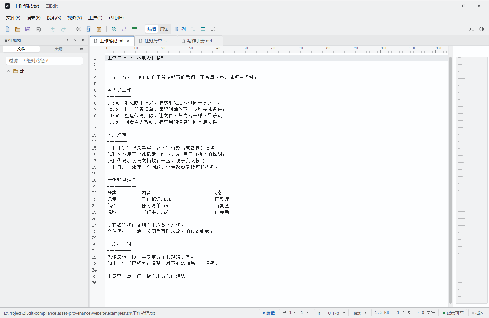
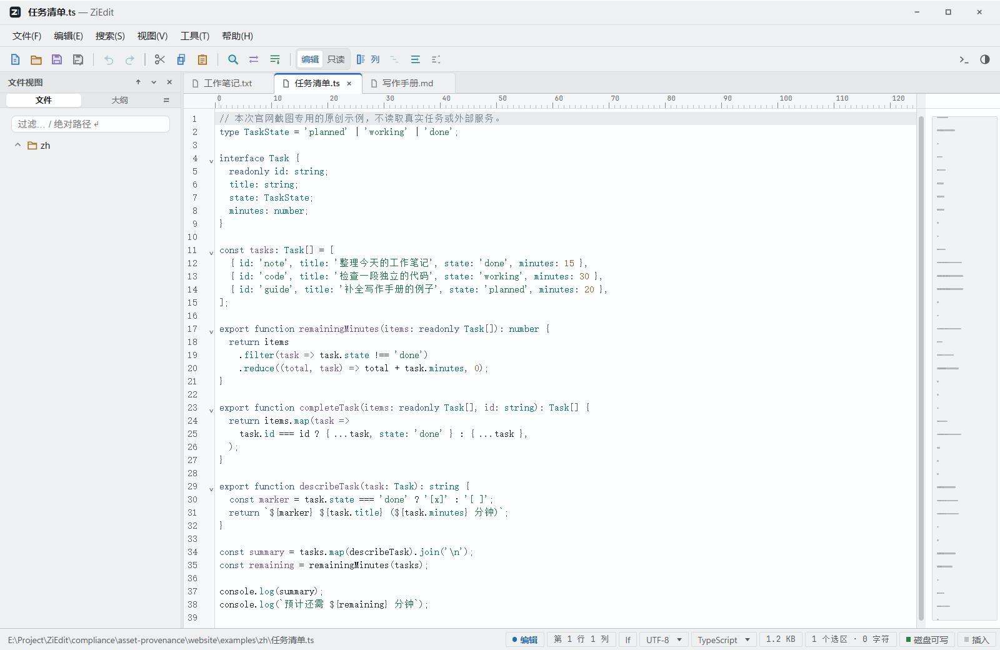

# ZiEdit

**[中文](README.md)** | [English](README.en.md)

跨平台、离线优先的桌面文件查看与编辑工具。Windows / macOS / Linux，基于 Tauri 2 + Rust + CodeMirror 6。

全程本地运行，不需要账号，不上传数据；唯一可选的联网能力是用户自行配置的 S3 兼容图床。

[](https://github.com/sylx-c/ZiEdit/releases/latest)
[](LICENSE)
[](https://github.com/sylx-c/ZiEdit/releases/latest)

<div align="center">

</div>

<!-- 操作演示 GIF：录制 20–30 秒真实操作（如：打开大文本文件 → Markdown 分屏编辑 → 双文件对比），
     存为 website/shots/demo.gif 后在此插入：
      -->

**一个窗口，多种格式**：文本 / 代码 / Markdown / CSV / TSV / 图片 / docx / xlsx / PDF，外加双文件对比。

| 纯文本 · 编码自动识别 | 源码 · 语法高亮 |
|:---:|:---:|
|  |  |

## 下载

<p align="center">
<a href="https://github.com/sylx-c/ZiEdit/releases/latest"></a>
</p>

- **Windows x64**：[Releases 最新版](https://github.com/sylx-c/ZiEdit/releases/latest) 提供 NSIS 安装包（附 SHA-256 校验值）。
- **macOS / Linux**：同一 Release 提供 dmg / AppImage / deb / rpm（CI 构建，未经实机测试；仅 Windows 经实机验证）。

## 功能特性

**文本与代码**
- 大文件查看：虚拟滚动 + 分块读取，日志级别文件秒开；日志尾板（tail）轮询刷新
- 编辑：多光标之外的矩形/列选区与列编辑、粘贴矩阵、书签、查找替换与批量替换、多文件查找、跳转行
- 编码：四级探测（BOM → 文件内声明 → 启发式 → 手动覆盖），支持 GBK / GB18030 / UTF-8/16/32 / Shift_JIS 等，可编码转换另存、Unicode 规范化另存
- 自动保存与崩溃恢复快照

**Markdown**
- 源码 / 预览 / 分屏 / 所见即所得四种模式，Live Preview 增量渲染
- MathJax 数学公式、Mermaid 图表、worker 化代码高亮、GFM 表格编辑、大纲导航、格式化
- 可选 S3 图床上传（去重、重命名模板；密钥仅保留在会话内存）

**多格式查看与对比**
- 图片查看（png/jpg/gif/webp/bmp/svg）、CSV/TSV 表格（可切换分隔符）
- docx / xlsx 只读提取、PDF 整页渲染查看（连续滚动、缩放、旋转；纯画布不支持正文选择与全文搜索）
- 双文件对比：并排 / 统一 / A-B 三视图，差异自动分类（同形字符、Unicode 规范化、不可见字符、空白、内容）

**工作台**
- 文件树（多选、收藏、最近文件、过滤）、命令面板、系统文件图标
- 主题、字体导入、界面缩放、中英双语（zh-CN / en-US）
- 系统文件关联：图片、文本/配置、Markdown、JSON/YAML/XML、CSV 与 24 种源码扩展名

## 使用指南

完整的中文与英文操作说明见 [docs/USER-GUIDE.md](docs/USER-GUIDE.md)，涵盖保存恢复、PDF/Office、会话导航、日志尾随台和快捷键。

## 更新日志

版本变化见 [docs/CHANGELOG.md](docs/CHANGELOG.md)；各版本安装包与 SHA-256 校验值见 [Releases](https://github.com/sylx-c/ZiEdit/releases)。

## 从源码构建

工程版本 1.0.0。环境要求：

- Node.js 24，npm
- Rust stable（rustup）
- Linux：`libwebkit2gtk-4.1-dev libappindicator3-dev librsvg2-dev patchelf`
- macOS：Xcode Command Line Tools；Windows：WebView2（系统自带或自动安装）

```bash
git clone https://github.com/sylx-c/ZiEdit.git
cd ZiEdit
npm ci
npm run tauri dev      # 开发运行
npm run tauri build    # 打安装包（Windows NSIS / macOS dmg.app / Linux appimage deb rpm）
```

仅调试前端（不启动桌面外壳）：`npm run dev`。

## 开发

常用命令、测试组织与提交前门禁见 [CONTRIBUTING.md](CONTRIBUTING.md)；CI 定义见 `.github/workflows/ci.yml`。

- 前端测试：`npm test`（vitest，按验收编号 ac-0XX 组织，数量以当次报告为准）
- Rust 测试：`cargo test --manifest-path src-tauri/Cargo.toml`（数量以当次报告为准）

## 参与贡献

[CONTRIBUTING.md](CONTRIBUTING.md) · 安全问题见 [SECURITY.md](SECURITY.md)

## 许可证

[MIT](LICENSE)。随应用分发的第三方组件（MathJax、Mermaid、highlight.js、JetBrains Mono 等）许可见 [THIRD-PARTY-NOTICES.md](THIRD-PARTY-NOTICES.md)。
