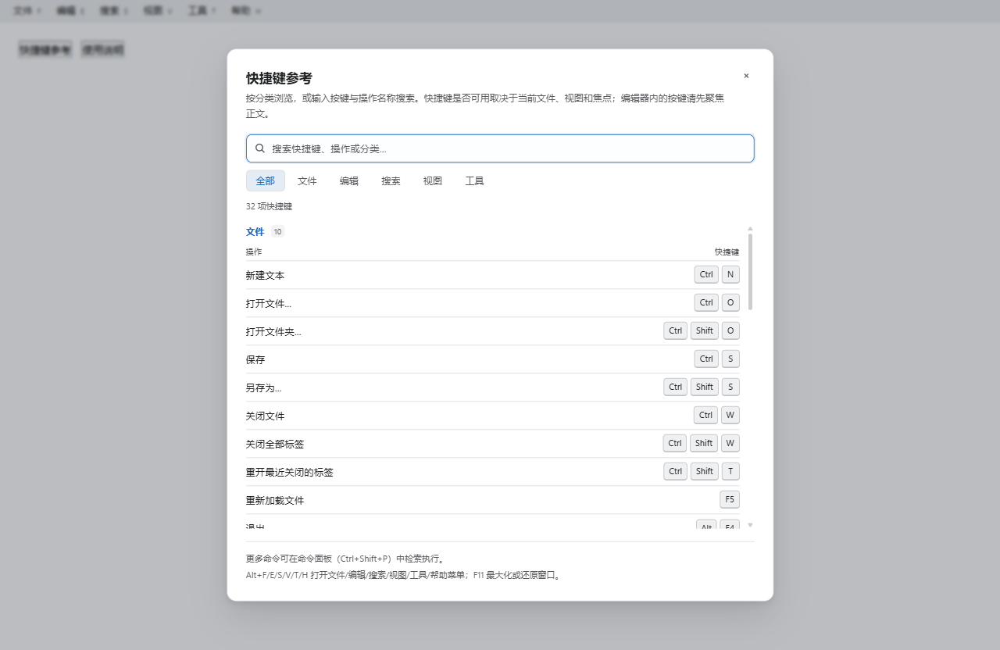
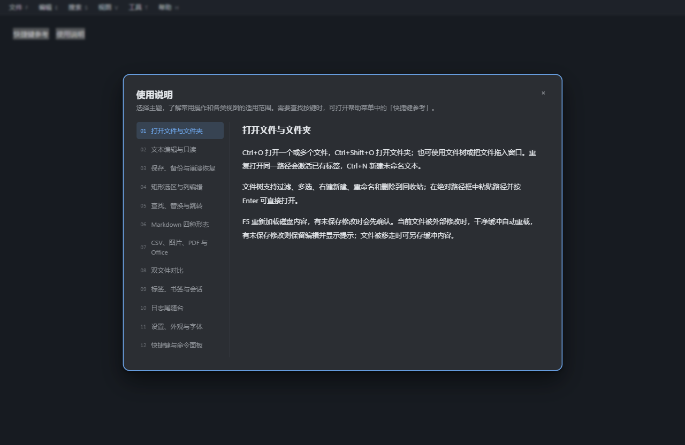

# 帮助与菜单细节整改（2026-11-05）

> 后续用户反馈：顶部菜单助记字母恢复原括号样式，改进重点转向展开内容；本页后续项已在同日后续任务实施，现状与截图以 [工作台整改记录](../workbench-refinement/README.md) 为准。本页保留第一轮经过与帮助中心证据。

本轮依据快捷键参考弹窗与顶部六菜单截图整改。沿用当前工作台布局、字号体系与 paper / cool / graphite / black 四主题；历史已否决的「蓝墨 V2」布局不作为实施依据。

## 本轮完成

- 快捷键参考：700px 常规宽度；搜索操作、按键和分类；按命令所属类别筛选；分组、数量、操作/键位两列与独立键帽。标题、检索区、底部提示固定，列表内部滚动，小窗口自适应。
- 快捷键从 ActionRegistry 读取，未另存一份按键表；当前没有快捷键的类别不显示空筛选项。打开即聚焦搜索，清空后继续输入；Esc 关闭并恢复原焦点。
- 顶部菜单保留 28px 栏高与原位置，名称和助记字母分层，统一悬停、展开与键盘焦点状态，保留 Alt 菜单入口。
- 使用说明：中英各 12 章、章节目录与键盘导航，正文独立滚动；补齐实际入口、步骤和功能限制。仓库完整指南见 [USER-GUIDE](../../USER-GUIDE.md)。
- 公共弹窗支持显式 autofocus，Tab 移入内部滚动区时保持焦点目标可见。

## 美术后续顺序

| 顺序 | 范围 | 具体做法 | 验收重点 |
|---|---|---|---|
| 本轮 | 帮助、快捷键、顶部菜单 | 信息分组、对齐、字重层级、边框、圆角、焦点 | 四主题、中英、小窗口、键盘关闭与恢复 |
| 下一轮 | 设置、右键菜单、长菜单 | 复用控件间距/状态规则；长菜单高度约束与子菜单翻转需一并处理，避免 overflow 裁掉子菜单 | 960×600、缩放、禁用/选中/展开状态、全项可达 |
| 后续 | 工具栏、标签、状态栏、空状态与错误状态 | 保留功能和位置，统一图标视觉重量、提示语与反馈层级，逐组件核对 | 截图对照、编辑/查看/对比不同模式、四主题 |

每轮只改一组组件，先给可查看结果，再根据实际反馈继续。主题颜色使用现有角色变量，新增图标保持现有 SVG 体系，不引入额外字体或图标包。

## 验证与证据

- `tests/ac-001-help.test.ts` 验证搜索与分类组合、无结果与清除、组合键显示、双语12章导航、初始焦点、Esc关闭和焦点恢复。
- 全量前端回归通过：170 个测试文件、1276 项测试。
- 浏览器直接加载生产帮助组件和样式，检查四主题的快捷键面板（1280×832、960×600、520×600）及中英文帮助章节，面板均处于视口内，正文可内部滚动。520px 为浏览器布局容错检查，原生窗口下限仍为960×600。
- 视觉页从应用源码提取字面量快捷键元数据用于排版；真实应用仍使用完整注册表，动态常量绑定不依赖该验证页。
- 前端构建与 Tauri debug/no-bundle 构建通过。截图来自组件验证页；本轮没有关闭或替换正在运行的安装版，也没有把旧安装版截图作为新构建验证。
- 尚未做真实系统150%/200% DPI操作验收；长菜单边界优化列入下一轮，不算本轮完成。

